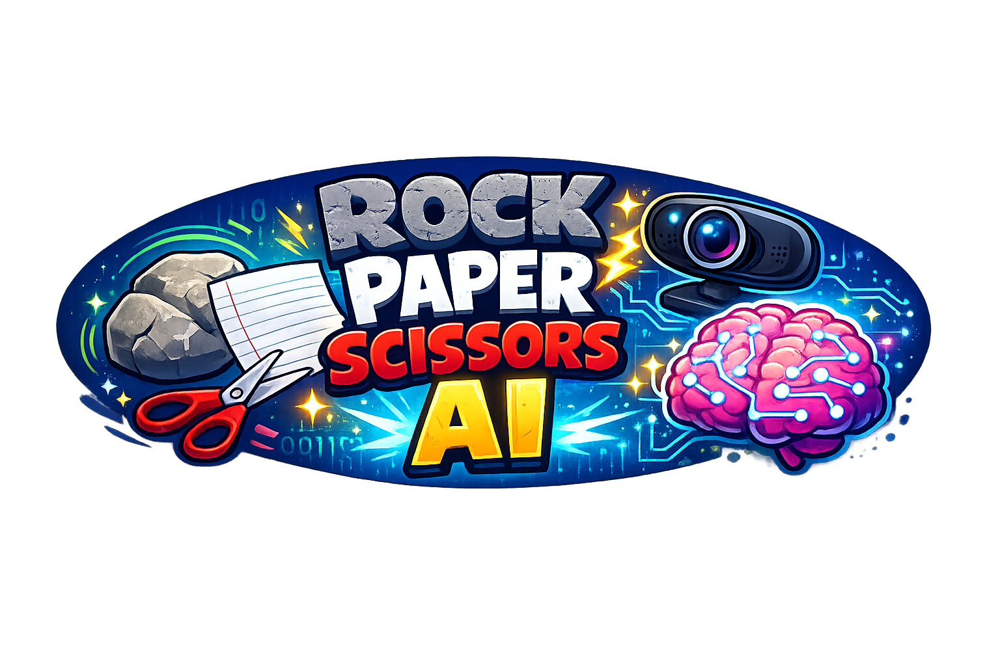

# Webcam Rock Paper Scissors

A classroom-friendly Python activity that turns a webcam into a rock-paper-scissors game.

This is the finished fallback version. It uses OpenCV for the camera window, MediaPipe for hand landmarks, and a small rule-based gesture classifier.

## Setup

Use Python 3.11 or 3.12.

```bash
python -m venv .venv
source .venv/bin/activate
pip install -r requirements.txt
python src/main.py
```

On Windows:

```bat
python -m venv .venv
.venv\Scripts\activate
pip install -r requirements.txt
python src\main.py
```

You can also run `./start.sh` on macOS/Linux or `start.bat` on Windows after installing the requirements.

If you previously installed the dependencies and see `AttributeError: module 'mediapipe' has no attribute 'solutions'`, run `pip install -r requirements.txt` again. The requirements file pins MediaPipe to a classroom-compatible version that still supports the simple `mp.solutions` API.

## Controls

- Show a rock, paper, or scissors gesture to the camera.
- Press `Space` to play a round.
- Press `R` to reset the score.
- Press `Q` to quit.

## Gesture Rules

- Rock: zero or one fingers extended
- Scissors: two fingers extended
- Paper: four or five fingers extended

Three fingers is treated as unknown so students get clear feedback when the gesture is not one of the game moves.
